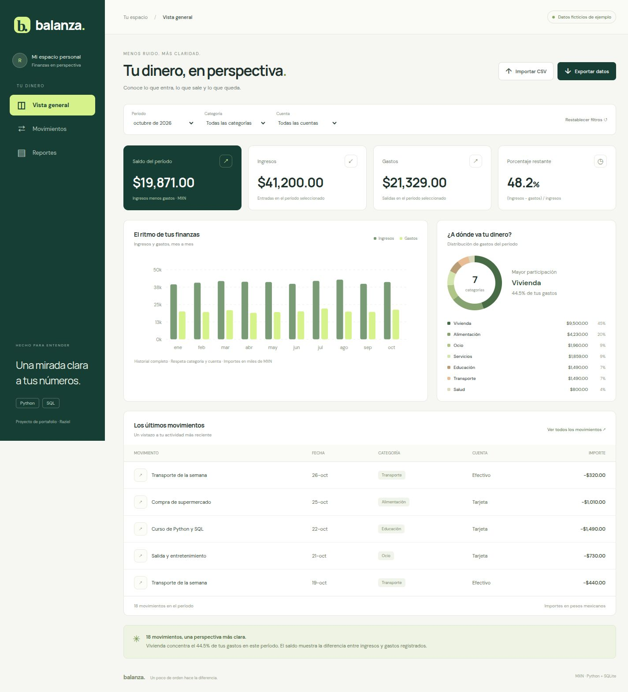

# Balanza · Finanzas personales

Panel web en español para entender ingresos, gastos y saldo mensual. Proyecto de portafolio de **desarrollo web, análisis de datos y automatización**, con Python y SQL como base.



## Qué resuelve

Convierte un CSV de movimientos en indicadores, gráficos y reportes mensuales. Permite filtrar por mes, categoría y cuenta, buscar movimientos y exportar resultados. Incluye **173 movimientos ficticios**, de enero a octubre de 2026, en pesos mexicanos; no son resultados ni finanzas reales de ninguna persona.

## Ejecutar en tu equipo

Requisito: Python 3.10 o posterior. No requiere instalar paquetes.

```bash
python3 app.py
```

Abre <http://127.0.0.1:8000>. La primera ejecución crea una base SQLite local con datos de ejemplo. Las importaciones se guardan en esa base y persisten al reiniciar. Para trabajar en una base nueva sin ejemplos:

```bash
python3 app.py --db data/personal.sqlite3 --empty --port 8001
```

El servidor incluido está pensado para desarrollo y demostraciones locales; escucha únicamente en el equipo que lo ejecuta. No incluye autenticación ni infraestructura de producción.

## Funciones

- Resumen: ingresos, gastos, saldo y porcentaje de ingresos que queda después de gastos.
- Gráfico mensual y distribución de gastos por categoría.
- Filtros combinados, búsqueda y paginación de movimientos.
- Importación de CSV validada antes de escribir; reimportar el mismo archivo no duplica movimientos.
- Rechazo completo del archivo si un ID existente contiene información distinta.
- Reportes Markdown mensuales y exportación CSV con neutralización de fórmulas.
- API local y consultas SQL de análisis con agregaciones, CTE y funciones de ventana.

## Arquitectura

```text
CSV → validación Python → SQLite → consultas SQL → API → panel web
                                  └────────────→ report.py → Markdown + CSV
```

`finance.py` concentra validaciones, importación y análisis SQL. `app.py` expone la API local usando la biblioteca estándar. `web/` contiene HTML, CSS y JavaScript de la interfaz. Los gráficos se dibujan con SVG y CSS, sin bibliotecas de gráficos. `sql/analysis.sql` reúne consultas adicionales para explicar el análisis en una entrevista.

La **demo alojada** se genera con `python3 build.py`: utiliza exclusivamente el CSV ficticio y realiza los cálculos en el navegador. Los archivos importados en esa demo no se envían al servidor ni persisten al recargar. La **versión local** ejecuta las consultas en SQLite y guarda las importaciones. La exportación de la demo nunca copia la base local ni los reportes del usuario.

## Modelo de datos y métricas

Una fila representa un movimiento, identificado por `id` único. Campos: `date`, `description`, `category`, `account`, `type` y `amount_cents`. Los importes se guardan como **centavos enteros** para evitar errores de redondeo acumulados.

| Métrica | Definición |
|---|---|
| Ingresos | Suma de movimientos de tipo `ingreso` |
| Gastos | Suma de movimientos de tipo `gasto` |
| Saldo del período | Ingresos menos gastos registrados; no es el saldo real de una cuenta |
| Porcentaje restante | `(ingresos − gastos) / ingresos × 100`; sin valor cuando no hay ingresos |

El gráfico mensual muestra el historial completo de las cuentas y categorías seleccionadas; las tarjetas y la distribución respetan también el mes. Las transferencias entre cuentas no tienen un tipo propio: deben excluirse del CSV para no contarlas dos veces. No se modelan deudas, inversiones ni varias monedas.

## Formato CSV

```csv
id,date,description,category,account,type,amount
PERSONAL-001,2026-11-01,Compra de supermercado,Alimentación,Tarjeta,gasto,580.50
PERSONAL-002,2026-11-01,Sueldo mensual,Sueldo,Cuenta bancaria,ingreso,32000.00
```

UTF-8, separador coma, encabezados en ese orden, fechas `AAAA-MM-DD`, tipo `ingreso` o `gasto`, importes positivos y hasta dos decimales con punto. Hasta 2 MB por archivo y 10,000 movimientos en total. Los campos de texto permiten hasta 120 caracteres. La importación admite comas y saltos dentro de campos entrecomillados. Los identificadores deben ser únicos dentro del archivo.

## Reportes automatizados

Este comando importa el CSV sin duplicar filas y genera el reporte de octubre y sus movimientos:

```bash
python3 report.py --csv data/demo.csv --month 2026-10 --output reports
```

También puedes usar una base existente:

```bash
python3 report.py --db data/personal.sqlite3 --month 2026-11
```

El comando no requiere interacción, por lo que puede integrarse a un programador de tareas. **No se instala ni se activa ninguna tarea programada automáticamente.** Los archivos generados y las bases locales están excluidos de Git.

## API local

| Método y ruta | Resultado |
|---|---|
| `GET /api/transactions` | Movimientos |
| `GET /api/summary?month=2026-10&account=Tarjeta` | Indicadores, categorías, historial y movimientos filtrados |
| `POST /api/import` | Importación transaccional de un cuerpo CSV UTF-8 |

Las consultas de filtros usan parámetros SQL. La importación HTTP rechaza orígenes externos. No existe acceso a cuentas bancarias ni credenciales financieras.

## Verificación

```bash
python3 -m unittest discover -s tests -v
```

Las pruebas cubren cálculo monetario, filtros, ausencia de ingresos, saldos negativos, validación de fechas e importes, importación idempotente, conflictos sin escritura parcial, CSV entrecomillados, consultas parametrizadas, reportes vacíos y la API HTTP.

La lógica de la demo tiene pruebas adicionales que requieren Node.js 18 o posterior:

```bash
node --test tests/analytics.test.mjs
```

## Para presentar el proyecto

1. Importa un CSV y explica por qué se validan todas las filas antes de guardar.
2. Filtra un mes y muestra cómo se obtienen ingresos, gastos y saldo con SQL.
3. Enseña el desglose por categoría y las consultas con funciones de ventana.
4. Genera un reporte desde la terminal para demostrar la automatización.
5. Explica las diferencias entre una demo local y una aplicación de producción.

Posibles mejoras: autenticación, PostgreSQL, transferencias entre cuentas, presupuestos y despliegue de la API con un servidor de producción.

Licencia: MIT.
